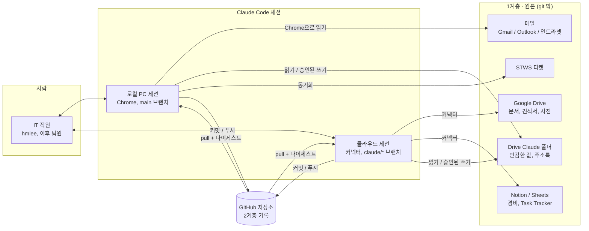
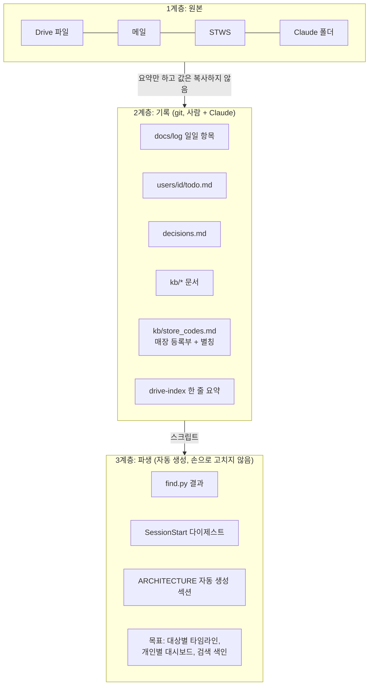
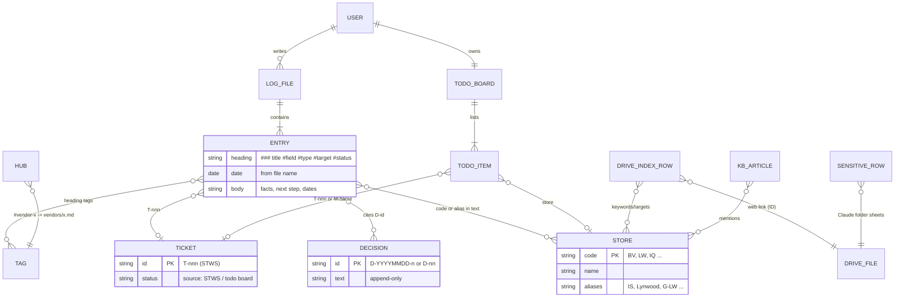
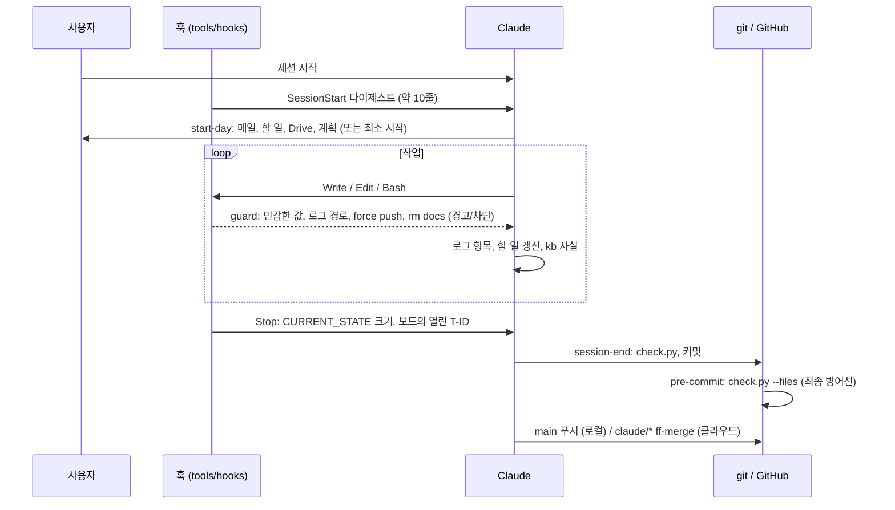

> 저장소 docs/ARCHITECTURE.md(영어 원본)의 2026-11-06 기준 한국어 번역본. 원본이 바뀌면 이 파일은 갱신되지 않음.

# 아키텍처 — USASIA IT 지식 저장소

> 저장소가 어떻게 구성되어 있고, 데이터가 어떻게 흐르며, 어떤 규칙을 따르는지 설명한다. 다이어그램은 GitHub에서 렌더링된다(Mermaid).
> 손으로 쓴 부분은 결정(decision)이 있을 때만 바꾼다. 끝의 **Generated** 섹션은
> `python tools/repo_map.py`로 다시 만들어진다(세션 종료 시 실행). 마지막 설계 검토: 2026-11-03 (D-20261103-7/-8, D-33, D-34).

## 1. 원칙 (요약)
| # | 원칙 | 출처 |
|---|---|---|
| P1 | **원본과 민감한 값은 Google Drive에 두고, GitHub에는 2차 기록만 둔다**(요약, 키워드, 링크, 결정, 날짜, 팁). 이메일, 전화번호, 계좌번호, 회선 ID → Drive Claude 폴더. 비밀번호와 키 → 어디에도 두지 않음 | docs/rules/security.md (R-SEC), D-20261102-2, -16 |
| P2 | **한 파일, 한 작성자.** 일일 로그는 사람별·날짜별로 파일 하나이고, 개인 상태는 `docs/users/<id>/`에 둔다. 공용 파일은 적게 두고 조심해서 고친다(커밋 전에 pull) | D-20261102-19, D-33 |
| P3 | **일어난 일을 기록하고, 상태는 한 곳에서만 관리한다.** 티켓이 있는 업무 → STWS ID, 개인 할 일 → `users/<id>/todo.md`. 로그에는 티켓 없는 대기 건에만 `#open/#waiting`을 붙인다 | D-20261102-18, D-20261103-8 |
| P4 | **손으로 만든 색인보다 검색.** 항목 하나 = `### title  #tags` 한 줄 + 본문. `find.py`가 동의어와 매장 코드 별칭으로 모든 문서를 검색한다. 허브는 필요할 때만 만들고, 손으로 쓴 이력 표는 두지 않는다 | D-20261102-5, -9 |
| P5 | **결정은 추가만 한다(append-only).** 이유는 decisions.md에 두고, 다른 문서는 ID로 인용한다. 대체된 줄에는 "→ 대체: D-x"를 붙인다 | D-20261102-10, D-33 |
| P6 | **기계가 확인할 수 있는 것은 기계가 확인한다.** check.py, git pre-commit, Claude Code 훅이 형식과 민감 데이터 규칙을 강제하고, CLAUDE.md에는 판단이 필요한 규칙만 남긴다 | D-20261103-6 |
| P7 | **매 세션은 가볍게, 깊은 점검은 주 1회.** 세션 종료 = 점검 + 커밋 + 푸시. 전체 검토와 프레임워크 제안은 월요일에 한다 | D-20261103-7 |
| P8 | **저장소 안은 영어, 채팅은 사용자의 언어.** 한국어 문서는 수정할 때 변환한다 | D-20261103-5, D-33 |

## 2. 시스템 컨텍스트


## 3. 데이터 계층 (현재 → 목표)


## 4. 데이터 모델 (ER)
마크다운 파일이 표 역할을 하고, ID가 조인 키다.


## 5. 세션 수명주기와 강제 방식


## 6. 경로별 쓰기 규칙
| 경로 | 계층 | 소유자 | 작성 주체 | 강제 수단 |
|---|---|---|---|---|
| `docs/log/YYYY/YYYY-MM-DD_<id>.md` | 2 | 해당 본인 | 본인 + Claude, 추가만 | guard log-path, check.py 태그 |
| `docs/users/<id>/` (todo, profile, CLAUDE.md) | 2 | 해당 본인 | 본인 + Claude | guard users-unknown |
| `docs/decisions.md` | 2 | 팀 | 추가만 | 검토 |
| `docs/kb/`, `docs/{vendors,stores,assets,projects}/` | 2 | 팀 | 로그에서 승격 | check.py hubs/INDEX |
| `docs/drive-index/` | 2 | 색인 담당 | 문서당 한 줄 | check.py sensitive |
| `docs/CURRENT_STATE.md` | 2 | 팀 | 저장소/프레임워크 상태, 80줄 이하 | stop-state |
| `.claude/skills/`, `CLAUDE.md`, `tools/` | 프레임워크 | 관리자 | 주간 검토 때만 | test_hooks.py |
| Drive Claude 폴더 | 1 | 각자 | 승인된 쓰기, 로컬 세션 | session-end 주간 공유 점검 |

## 7. 목표 설계 (2026-11-03 합의, 11/17 검토에서 결정)
- 매장 등록부 먼저(store_codes.md + 별칭, 검색용 단일 출처). 자산/회선은 처음 필요할 때 ID를 부여
- 항목 아래에 선택적 기계용 줄: `store=LW vendor=x ticket=T-606`, 등록부와 대조해 검증
- 기록에서 개인별 다이제스트/대시보드를 생성. CURRENT_STATE는 짧은 저장소 메모로 유지
- Drive 파일 이름 규칙: `YYYY-MM-DD_<store>_<what>.ext`. git에는 바이너리 파일 금지
- 팀원 합류 시: CODEOWNERS, 신원 가져오기 테스트, 주간 승격(KCS evolve loop)

<!-- GENERATED:BEGIN (tools/repo_map.py — do not edit by hand) -->
## 8. 자동 생성 스냅샷
_2026-11-06 tools/repo_map.py로 재생성._

| 항목 | 값 |
|---|---|
| 파일 수 / 크기 | 202 / 799 KB |
| 콘텐츠 대 프레임워크 | 225 KB 대 574 KB (프레임워크 71%) |
| 로그 파일 / 항목 | 4 / 98 |
| 사용자 | hmlee |
| 결정 | 51 |
| 매장 코드 | 21 |

### 스킬 (.claude/skills)
| 스킬 | 사용 시점 |
|---|---|
| drive-check | 매달 초 드라이브 점검. 색인에 있는 파일의 삭제·휴지통·이름·공유 변경을 찾고 Claude 폴더 월 백업을 만든다. start-day가 이번 달 점검이 안 됐으면 부른다. "월초 점검", "드라이 |
| drive-index | 구글 드라이브 폴더를 커넥터로 읽어 문서별 목적·담긴 정보·대상·공유 상태·링크를 docs/drive-index에 색인. 하위 에이전트 병렬 분담과 재작업 방지 브리프 포함. "드라이브 색인", " |
| mail-triage | Gmail·Outlook·인트라넷 메일을 크롬으로 읽고(메일을 열지 않음) mail_triage.md 기준으로 할 일/기다림/참고/자동·버림 분류, 업무 기록에 반영. 새 연락처·조직은 즉시 사용자 |
| review-loop | 무거운 작업을 만든 뒤 새 Sonnet이 검토 — diff와 규칙 파일을 넣으면 규칙 ID를 인용한 이의가 나오고, 수용 또는 반박(최대 2라운드) |
| session-end | 세션 마무리와 인계. 매 세션 — check.py, 열린 항목을 할 일 보드로, 새 사실/결정, 커밋 |
| start-day | USASIA IT 업무 시작 루틴. 저장소 동기화, 상태·열린 건·일정 확인, Gmail·Outlook 새 메일과 드라이브 변경을 훑어 오늘 할 일 표를 만들고 승인받는다. "업무 시작", "아침  |
| todo | 사용자가 말로 준 새 요청을 할 일 목록에 추가. 메시지가 "Todo", "todo:", "할일:"로 시작하거나 "/todo"일 때 사용. 한 메시지에 여러 건이어도 됨. |
| todo-sync | 개인 할 일 보드(docs/users/<id>/todo.md)와 STWS 티켓(보고용)을 동기화하고 "지금" 할 일을 제안한다. "할 일 목록", "티켓 동기화", "STWS 동기화" 때 사용 (" |
| weekly-meeting | 주간 IT 정기 회의(매주 월요일 10:00) 준비와 정리. 회의 전에는 드라이브 Meeting 폴더에 이번 주 회의록 틀을 만들고, 회의 뒤에는 사용자가 적은 결정·To-do를 저장소 기록·tod |

### 훅 규칙 모드 (tools/hooks/config.json)
| 모드 | 규칙 |
|---|---|
| block | sens-email, sens-secret, git-force, rm-docs, stop-state, stop-open, heavy-review |
| warn | digest, log-path, users-unknown, area-keyword, area-read |
| off | probe, sens-soft, english-nudge, budget, account-detect |

### 트리 (깊이 3)
```
.
├── .claude/                           105 files, 404.2 KB
│   ├── settings.json                      0.5 KB
│   ├── skills/                            9 files, 32.1 KB
│   │   ├── drive-check/                       1 files, 2.4 KB
│   │   ├── drive-index/                       1 files, 4.6 KB
│   │   ├── mail-triage/                       1 files, 5.5 KB
│   │   ├── review-loop/                       1 files, 2.7 KB
│   │   ├── session-end/                       1 files, 3.8 KB
│   │   ├── start-day/                         1 files, 3.5 KB
│   │   ├── todo/                              1 files, 3.1 KB
│   │   ├── todo-sync/                         1 files, 4.3 KB
│   │   ├── weekly-meeting/                    1 files, 2.2 KB
│   ├── worktrees/                         95 files, 371.6 KB
│   │   ├── compassionate-antonelli-e41a7b/    95 files, 371.6 KB
├── .gitattributes                     0.0 KB
├── .gitignore                         0.3 KB
├── CLAUDE.md                          2.7 KB
├── README.md                          0.1 KB
├── docs/                              75 files, 315.5 KB
│   ├── CURRENT_STATE.md                   5.3 KB
│   ├── archive/                           3 files, 4.2 KB
│   │   ├── .gitkeep                           0.0 KB
│   │   ├── 2026/                              2 files, 4.2 KB
│   ├── assets/                            1 files, 0.0 KB
│   │   ├── INDEX.md                           0.0 KB
│   ├── calendar.md                        0.6 KB
│   ├── decisions.md                       24.5 KB
│   ├── drive-index/                       7 files, 64.9 KB
│   │   ├── INDEX.md                           2.1 KB
│   │   ├── archive-saves.md                   11.2 KB
│   │   ├── claude-folder.md                   3.2 KB
│   │   ├── claudework-itil-root.md            7.2 KB
│   │   ├── meeting-templates-programs.md      13.3 KB
│   │   ├── ongoing-project.md                 13.9 KB
│   │   ├── purchase-reimbursement.md          14.0 KB
│   ├── kb/                                11 files, 40.3 KB
│   │   ├── INDEX.md                           2.2 KB
│   │   ├── browser.md                         1.6 KB
│   │   ├── facts.md                           2.4 KB
│   │   ├── field_media.md                     1.6 KB
│   │   ├── mail_triage.md                     4.5 KB
│   │   ├── orgs.md                            6.4 KB
│   │   ├── pos_tips.md                        0.4 KB
│   │   ├── reimbursement.md                   2.0 KB
│   │   ├── store_codes.md                     1.6 KB
│   │   ├── subagents.md                       4.9 KB
│   │   ├── work_overview.md                   12.6 KB
│   ├── keywords.md                        1.2 KB
│   ├── log/                               5 files, 43.2 KB
│   │   ├── 2026/                              5 files, 43.2 KB
│   ├── project_instructions.md            2.0 KB
│   ├── projects/                          4 files, 7.4 KB
│   │   ├── INDEX.md                           0.3 KB
│   │   ├── ai-system-questions.md             3.9 KB
│   │   ├── ai-system.md                       0.9 KB
│   │   ├── granite-dia.md                     2.3 KB
│   ├── requests/                          13 files, 83.7 KB
│   │   ├── PLAN-data-migration-001-draft2.md  26.7 KB
│   │   ├── PLAN-lean-context-001-draft2.md    4.9 KB
│   │   ├── PLAN-master-data-glpi-001-draft1.md 3.6 KB
│   │   ├── PLAN-onboarding-001-draft2.md      8.7 KB
│   │   ├── PLAN-rule-routing-001-draft2.md    10.3 KB
│   │   ├── PLAN-structure-001-draft2.md       1.0 KB
│   │   ├── PLAN-usasia-db-phase0-001-draft3.md 8.0 KB
│   │   ├── PLAN-usasia-db-todos-001-draft2.md 3.0 KB
│   │   ├── archive/                           5 files, 17.6 KB
│   ├── rules/                             5 files, 9.1 KB
│   │   ├── INDEX.md                           1.5 KB
│   │   ├── expense.md                         1.8 KB
│   │   ├── log.md                             1.6 KB
│   │   ├── lookup.md                          2.7 KB
│   │   ├── security.md                        1.6 KB
│   ├── storage_rules.md                   0.1 KB
│   ├── stores/                            1 files, 0.0 KB
│   │   ├── INDEX.md                           0.0 KB
│   ├── team/                              6 files, 5.3 KB
│   │   ├── INDEX.md                           1.5 KB
│   │   ├── andy-han.md                        1.0 KB
│   │   ├── dan-choi.md                        1.1 KB
│   │   ├── fellix-lyu.md                      0.3 KB
│   │   ├── james-yoo.md                       0.6 KB
│   │   ├── tommy-song.md                      0.8 KB
│   ├── templates/                         7 files, 3.9 KB
│   │   ├── asset.md                           0.5 KB
│   │   ├── daily_log.md                       1.2 KB
│   │   ├── drive_index.md                     0.2 KB
│   │   ├── project.md                         0.3 KB
│   │   ├── store.md                           0.4 KB
│   │   ├── user_profile.md                    1.0 KB
│   │   ├── vendor.md                          0.3 KB
│   ├── users/                             4 files, 18.9 KB
│   │   ├── INDEX.md                           1.6 KB
│   │   ├── hmlee/                             3 files, 17.3 KB
│   ├── vendors/                           2 files, 0.7 KB
│   │   ├── INDEX.md                           0.1 KB
│   │   ├── itsolution.md                      0.5 KB
├── tools/                             18 files, 75.8 KB
│   ├── browser/                           1 files, 2.0 KB
│   │   ├── outlook_list.js                    2.0 KB
│   ├── check.py                           6.2 KB
│   ├── find.py                            6.8 KB
│   ├── githooks/                          1 files, 0.7 KB
│   │   ├── pre-commit                         0.7 KB
│   ├── hooks/                             12 files, 49.2 KB
│   │   ├── README.md                          4.1 KB
│   │   ├── area.py                            5.0 KB
│   │   ├── common.py                          1.5 KB
│   │   ├── config.json                        1.2 KB
│   │   ├── digest.py                          8.2 KB
│   │   ├── guard.py                           6.3 KB
│   │   ├── launch.sh                          0.6 KB
│   │   ├── probe.py                           0.8 KB
│   │   ├── review_mark.py                     1.0 KB
│   │   ├── stop.py                            4.3 KB
│   │   ├── test_hooks.py                      14.5 KB
│   │   ├── touch.py                           1.6 KB
│   ├── prune.py                           6.7 KB
│   ├── repo_map.py                        4.1 KB
```
<!-- GENERATED:END -->
