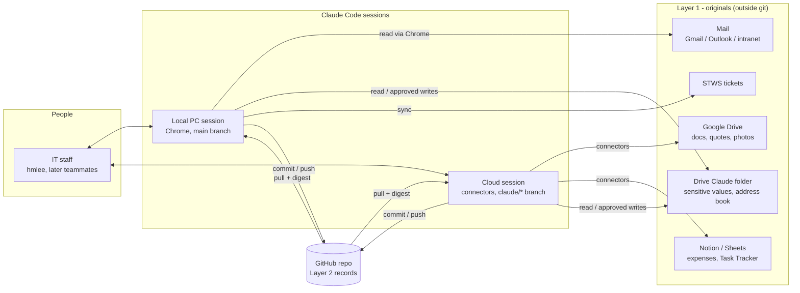
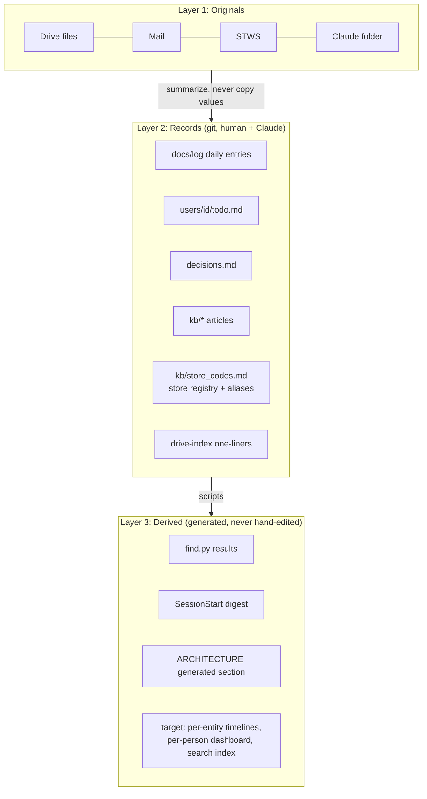
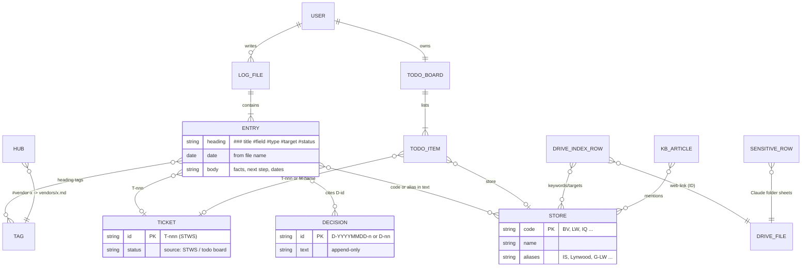
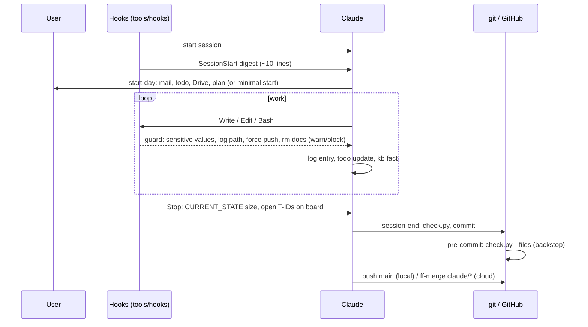

# Architecture — USASIA IT knowledge repo

> How the repo is built, how data flows, and the rules it follows. Diagrams render on GitHub (Mermaid).
> Hand-written parts change only with a decision. The **Generated** section at the end is rebuilt by
> `python tools/repo_map.py` (run at session end). Last design review: 2026-11-03 (D-20261103-7/-8, D-33, D-34).

## 1. Principles (summary)
| # | Principle | Source |
|---|---|---|
| P1 | **Originals and sensitive values live in Google Drive; GitHub holds secondary records only** (summaries, keywords, links, decisions, dates, tips). Emails, phones, account numbers, circuit IDs → Drive Claude folder. Passwords and keys → nowhere | docs/rules/security.md (R-SEC), D-20261102-2, -16 |
| P2 | **One file, one writer.** Daily logs are one file per person per day; personal state lives in `docs/users/<id>/`. Shared files are few and edited carefully (pull before commit) | D-20261102-19, D-33 |
| P3 | **Record what happened; status lives in one place.** Ticketed work → STWS ID; personal tasks → `users/<id>/todo.md`. Logs carry `#open/#waiting` only for un-ticketed waits | D-20261102-18, D-20261103-8 |
| P4 | **Search over hand-made indexes.** Each entry = one `### title  #tags` line + body; `find.py` searches all docs with synonyms and store-code aliases. Hubs are created only when needed; no hand-written history tables | D-20261102-5, -9 |
| P5 | **Decisions are append-only.** Reasons live in decisions.md; other docs cite the ID. Superseded lines get "→ 대체: D-x" | D-20261102-10, D-33 |
| P6 | **Machines check what can be checked.** check.py, git pre-commit and Claude Code hooks enforce format and sensitive-data rules; CLAUDE.md keeps judgment rules only | D-20261103-6 |
| P7 | **Light every session, deep once a week.** Session end = check + commit + push; full review and framework proposals on Monday | D-20261103-7 |
| P8 | **English inside the repo, user's language in chat.** Korean docs convert when edited | D-20261103-5, D-33 |

## 2. System context


## 3. Data layers (current → target)


## 4. Data model (ER)
Markdown files act as tables; IDs are the join keys.


## 5. Session lifecycle and enforcement


## 6. Write rules by path
| Path | Layer | Owner | Written by | Enforced by |
|---|---|---|---|---|
| `docs/log/YYYY/YYYY-MM-DD_<id>.md` | 2 | that person | person + Claude, append | guard log-path, check.py tags |
| `docs/users/<id>/` (todo, profile, CLAUDE.md) | 2 | that person | person + Claude | guard users-unknown |
| `docs/decisions.md` | 2 | team | append-only | review |
| `docs/kb/`, `docs/{vendors,stores,assets,projects}/` | 2 | team | promote from logs | check.py hubs/INDEX |
| `docs/drive-index/` | 2 | indexer | one line per doc | check.py sensitive |
| `docs/CURRENT_STATE.md` | 2 | team | repo/framework state, ≤80 lines | stop-state |
| `.claude/skills/`, `CLAUDE.md`, `tools/` | framework | maintainer | weekly review only | test_hooks.py |
| Drive Claude folder | 1 | each person | approved writes, local session | session-end weekly share check |

## 7. Target design (agreed 2026-11-03, decide at 11/17 review)
- Store registry first (store_codes.md + aliases, one source for search); assets/circuits get IDs when first needed
- Optional machine line under an entry: `store=LW vendor=x ticket=T-606`, validated against the registry
- Per-person digest/dashboard generated from records; CURRENT_STATE stays a short repo note
- Drive file naming: `YYYY-MM-DD_<store>_<what>.ext`; block binary files in git
- At teammate join: CODEOWNERS, identity import test, weekly promote (KCS evolve loop)

<!-- GENERATED:BEGIN (tools/repo_map.py — do not edit by hand) -->
## 8. Generated snapshot
_Rebuilt 2026-11-06 by tools/repo_map.py._

| Metric | Value |
|---|---|
| Files / size | 202 / 799 KB |
| Content vs framework | 225 KB vs 574 KB (71% framework) |
| Log files / entries | 4 / 98 |
| Users | hmlee |
| Decisions | 51 |
| Store codes | 21 |

### Skills (.claude/skills)
| Skill | When |
|---|---|
| drive-check | 매달 초 드라이브 점검. 색인에 있는 파일의 삭제·휴지통·이름·공유 변경을 찾고 Claude 폴더 월 백업을 만든다. start-day가 이번 달 점검이 안 됐으면 부른다. "월초 점검", "드라이 |
| drive-index | 구글 드라이브 폴더를 커넥터로 읽어 문서별 목적·담긴 정보·대상·공유 상태·링크를 docs/drive-index에 색인. 하위 에이전트 병렬 분담과 재작업 방지 브리프 포함. "드라이브 색인", " |
| mail-triage | Gmail·Outlook·인트라넷 메일을 크롬으로 읽고(메일을 열지 않음) mail_triage.md 기준으로 할 일/기다림/참고/자동·버림 분류, 업무 기록에 반영. 새 연락처·조직은 즉시 사용자 |
| review-loop | Post-build review of heavy work by a fresh Sonnet — diff + rule files in, objections citing rule IDs out, acce |
| session-end | Session wrap-up and handoff. Every session — check.py, open items to the todo board, new facts/decisions, comm |
| start-day | USASIA IT 업무 시작 루틴. 저장소 동기화, 상태·열린 건·일정 확인, Gmail·Outlook 새 메일과 드라이브 변경을 훑어 오늘 할 일 표를 만들고 승인받는다. "업무 시작", "아침  |
| todo | 사용자가 말로 준 새 요청을 할 일 목록에 추가. 메시지가 "Todo", "todo:", "할일:"로 시작하거나 "/todo"일 때 사용. 한 메시지에 여러 건이어도 됨. |
| todo-sync | 개인 할 일 보드(docs/users/<id>/todo.md)와 STWS 티켓(보고용)을 동기화하고 "지금" 할 일을 제안한다. "할 일 목록", "티켓 동기화", "STWS 동기화" 때 사용 (" |
| weekly-meeting | 주간 IT 정기 회의(매주 월요일 10:00) 준비와 정리. 회의 전에는 드라이브 Meeting 폴더에 이번 주 회의록 틀을 만들고, 회의 뒤에는 사용자가 적은 결정·To-do를 저장소 기록·tod |

### Hook rule modes (tools/hooks/config.json)
| Mode | Rules |
|---|---|
| block | sens-email, sens-secret, git-force, rm-docs, stop-state, stop-open, heavy-review |
| warn | digest, log-path, users-unknown, area-keyword, area-read |
| off | probe, sens-soft, english-nudge, budget, account-detect |

### Tree (depth 3)
```
.
├── .claude/                           105 files, 404.2 KB
│   ├── settings.json                      0.5 KB
│   ├── skills/                            9 files, 32.1 KB
│   │   ├── drive-check/                       1 files, 2.4 KB
│   │   ├── drive-index/                       1 files, 4.6 KB
│   │   ├── mail-triage/                       1 files, 5.5 KB
│   │   ├── review-loop/                       1 files, 2.7 KB
│   │   ├── session-end/                       1 files, 3.8 KB
│   │   ├── start-day/                         1 files, 3.5 KB
│   │   ├── todo/                              1 files, 3.1 KB
│   │   ├── todo-sync/                         1 files, 4.3 KB
│   │   ├── weekly-meeting/                    1 files, 2.2 KB
│   ├── worktrees/                         95 files, 371.6 KB
│   │   ├── compassionate-antonelli-e41a7b/    95 files, 371.6 KB
├── .gitattributes                     0.0 KB
├── .gitignore                         0.3 KB
├── CLAUDE.md                          2.7 KB
├── README.md                          0.1 KB
├── docs/                              75 files, 315.5 KB
│   ├── CURRENT_STATE.md                   5.3 KB
│   ├── archive/                           3 files, 4.2 KB
│   │   ├── .gitkeep                           0.0 KB
│   │   ├── 2026/                              2 files, 4.2 KB
│   ├── assets/                            1 files, 0.0 KB
│   │   ├── INDEX.md                           0.0 KB
│   ├── calendar.md                        0.6 KB
│   ├── decisions.md                       24.5 KB
│   ├── drive-index/                       7 files, 64.9 KB
│   │   ├── INDEX.md                           2.1 KB
│   │   ├── archive-saves.md                   11.2 KB
│   │   ├── claude-folder.md                   3.2 KB
│   │   ├── claudework-itil-root.md            7.2 KB
│   │   ├── meeting-templates-programs.md      13.3 KB
│   │   ├── ongoing-project.md                 13.9 KB
│   │   ├── purchase-reimbursement.md          14.0 KB
│   ├── kb/                                11 files, 40.3 KB
│   │   ├── INDEX.md                           2.2 KB
│   │   ├── browser.md                         1.6 KB
│   │   ├── facts.md                           2.4 KB
│   │   ├── field_media.md                     1.6 KB
│   │   ├── mail_triage.md                     4.5 KB
│   │   ├── orgs.md                            6.4 KB
│   │   ├── pos_tips.md                        0.4 KB
│   │   ├── reimbursement.md                   2.0 KB
│   │   ├── store_codes.md                     1.6 KB
│   │   ├── subagents.md                       4.9 KB
│   │   ├── work_overview.md                   12.6 KB
│   ├── keywords.md                        1.2 KB
│   ├── log/                               5 files, 43.2 KB
│   │   ├── 2026/                              5 files, 43.2 KB
│   ├── project_instructions.md            2.0 KB
│   ├── projects/                          4 files, 7.4 KB
│   │   ├── INDEX.md                           0.3 KB
│   │   ├── ai-system-questions.md             3.9 KB
│   │   ├── ai-system.md                       0.9 KB
│   │   ├── granite-dia.md                     2.3 KB
│   ├── requests/                          13 files, 83.7 KB
│   │   ├── PLAN-data-migration-001-draft2.md  26.7 KB
│   │   ├── PLAN-lean-context-001-draft2.md    4.9 KB
│   │   ├── PLAN-master-data-glpi-001-draft1.md 3.6 KB
│   │   ├── PLAN-onboarding-001-draft2.md      8.7 KB
│   │   ├── PLAN-rule-routing-001-draft2.md    10.3 KB
│   │   ├── PLAN-structure-001-draft2.md       1.0 KB
│   │   ├── PLAN-usasia-db-phase0-001-draft3.md 8.0 KB
│   │   ├── PLAN-usasia-db-todos-001-draft2.md 3.0 KB
│   │   ├── archive/                           5 files, 17.6 KB
│   ├── rules/                             5 files, 9.1 KB
│   │   ├── INDEX.md                           1.5 KB
│   │   ├── expense.md                         1.8 KB
│   │   ├── log.md                             1.6 KB
│   │   ├── lookup.md                          2.7 KB
│   │   ├── security.md                        1.6 KB
│   ├── storage_rules.md                   0.1 KB
│   ├── stores/                            1 files, 0.0 KB
│   │   ├── INDEX.md                           0.0 KB
│   ├── team/                              6 files, 5.3 KB
│   │   ├── INDEX.md                           1.5 KB
│   │   ├── andy-han.md                        1.0 KB
│   │   ├── dan-choi.md                        1.1 KB
│   │   ├── fellix-lyu.md                      0.3 KB
│   │   ├── james-yoo.md                       0.6 KB
│   │   ├── tommy-song.md                      0.8 KB
│   ├── templates/                         7 files, 3.9 KB
│   │   ├── asset.md                           0.5 KB
│   │   ├── daily_log.md                       1.2 KB
│   │   ├── drive_index.md                     0.2 KB
│   │   ├── project.md                         0.3 KB
│   │   ├── store.md                           0.4 KB
│   │   ├── user_profile.md                    1.0 KB
│   │   ├── vendor.md                          0.3 KB
│   ├── users/                             4 files, 18.9 KB
│   │   ├── INDEX.md                           1.6 KB
│   │   ├── hmlee/                             3 files, 17.3 KB
│   ├── vendors/                           2 files, 0.7 KB
│   │   ├── INDEX.md                           0.1 KB
│   │   ├── itsolution.md                      0.5 KB
├── tools/                             18 files, 75.8 KB
│   ├── browser/                           1 files, 2.0 KB
│   │   ├── outlook_list.js                    2.0 KB
│   ├── check.py                           6.2 KB
│   ├── find.py                            6.8 KB
│   ├── githooks/                          1 files, 0.7 KB
│   │   ├── pre-commit                         0.7 KB
│   ├── hooks/                             12 files, 49.2 KB
│   │   ├── README.md                          4.1 KB
│   │   ├── area.py                            5.0 KB
│   │   ├── common.py                          1.5 KB
│   │   ├── config.json                        1.2 KB
│   │   ├── digest.py                          8.2 KB
│   │   ├── guard.py                           6.3 KB
│   │   ├── launch.sh                          0.6 KB
│   │   ├── probe.py                           0.8 KB
│   │   ├── review_mark.py                     1.0 KB
│   │   ├── stop.py                            4.3 KB
│   │   ├── test_hooks.py                      14.5 KB
│   │   ├── touch.py                           1.6 KB
│   ├── prune.py                           6.7 KB
│   ├── repo_map.py                        4.1 KB
```
<!-- GENERATED:END -->
